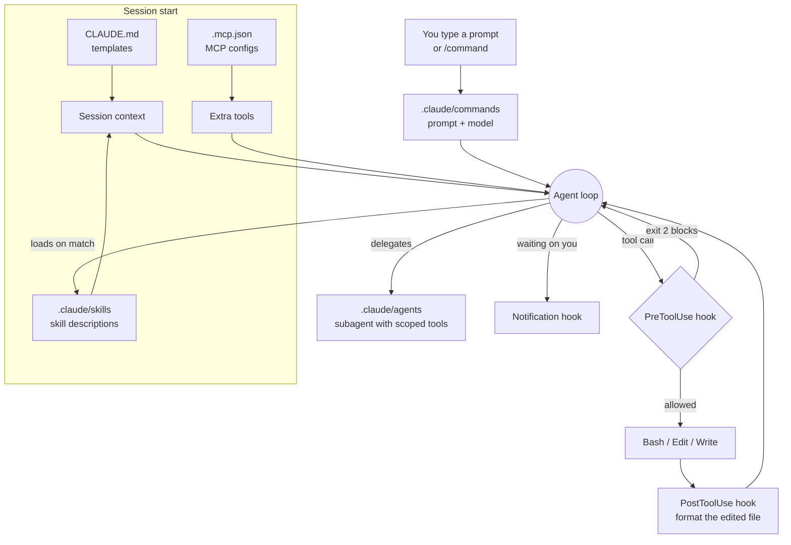

# Claude Code Recipes

[](https://github.com/Sagargupta16/claude-code-recipes/actions/workflows/ci.yml)

> **49 copy-paste recipes** for Claude Code - commands, subagents, hooks, skills, and MCP configs that work out of the box. Install them as plugins in two commands, or copy the files you want.

Stop configuring from scratch. Drop these recipes into your `.claude/` folder and start building.

Something installed but silent? Claude Code config fails quietly, so start at [TROUBLESHOOTING.md](TROUBLESHOOTING.md).

---

## Install as Plugins

The repo is also a Claude Code plugin marketplace. Inside Claude Code:

```text
/plugin marketplace add Sagargupta16/claude-code-recipes
/plugin install recipe-commands@claude-code-recipes
```

On Claude Code 2.1.275 or later, one line does both:

```text
/plugin install recipe-commands --marketplace Sagargupta16/claude-code-recipes
```

Each plugin is one recipe type, so you take only what fits:

| Plugin | Installs | Know before you install |
|--------|----------|-------------------------|
| `recipe-commands` | The 15 [commands](#commands-15-recipes), as `/recipe-commands:code-review` and so on | `/check-all-prs`, `/audit-repos` and `/update-status` assume the `gh` CLI |
| `recipe-agents` | The 9 [subagents](#subagents-9-recipes) | Generic, no stack assumptions |
| `recipe-skills` | The 5 [skills](#skills-5-recipes) | Stack-specific: React, TypeScript, REST. Skip it if that is not your stack |
| `recipe-hooks` | Lint on `git commit`, tests on `git push`, format on edit, desktop notification | Needs `jq`. Blocks a commit or push when your own linter or test suite fails |
| `recipe-guards` | [Dangerous command guard](hooks/block-dangerous-commands.sh) and [secret scan](hooks/secret-scan.sh) | Needs `jq`. Safe to add to any project |

[scripts/build_marketplace.py](scripts/build_marketplace.py) generates [.claude-plugin/marketplace.json](.claude-plugin/marketplace.json) from the files on disk, and CI fails if the two drift, so a new recipe cannot miss the plugins. CI also runs `claude plugin validate --strict` on it. MCP configs and CLAUDE.md templates stay copy-paste: they need your own connection strings and project details.

---

## How to Use

1. Browse the recipe catalog below
2. Copy the file you need
3. Paste it into your project's `.claude/` directory:
   - Commands go in `.claude/commands/`
   - Subagents go in `.claude/agents/`
   - Skills go in `.claude/skills/`
   - Hooks go in `.claude/settings.json`
   - MCP configs go in `.mcp.json`
4. Use it immediately - every recipe works out of the box

---

## Where Each Recipe Plugs In

Every recipe type hooks into a different point of a Claude Code session. Knowing which one fires when is most of the debugging when a recipe stays silent.



| Recipe type | Loaded | Scope it controls |
|-------------|--------|-------------------|
| CLAUDE.md template | Every session start | Project conventions Claude always sees |
| MCP config | Session start, one process or remote endpoint per server | Extra tools (GitHub, Postgres, docs lookup) |
| Skill | Description at start, body only when the task matches | Domain knowledge without paying for it on every turn |
| Command | When you type `/name` | One reusable prompt, pinned to a model |
| Subagent | When the main loop delegates | A separate context window with its own tool allowlist |
| Hook | On a lifecycle event (`PreToolUse`, `PostToolUse`, `Notification`, `Stop`) | Deterministic checks that do not depend on the model remembering |
| Workflow | Read by you | Which of the above to chain, in which permission mode |

---

## Recipe Catalog

### Commands (15 recipes)

Drop these into `.claude/commands/` and use them with `/command-name`.

| Recipe | What It Does | Model | Link |
|--------|-------------|:-----:|------|
| `/code-review` | Review staged changes for bugs, style, and security | sonnet | [code-review.md](commands/code-review.md) |
| `/pr-description` | Generate PR title + description from branch diff | haiku | [pr-description.md](commands/pr-description.md) |
| `/commit-message` | Generate conventional commit message | haiku | [commit-message.md](commands/commit-message.md) |
| `/refactor` | Plan and execute a refactoring with safety checks | sonnet | [refactor.md](commands/refactor.md) |
| `/test-gen` | Generate tests for a file or function | sonnet | [test-gen.md](commands/test-gen.md) |
| `/doc-gen` | Generate documentation for code | haiku | [doc-gen.md](commands/doc-gen.md) |
| `/debug` | Systematic debugging: reproduce, isolate, fix, verify | opus | [debug.md](commands/debug.md) |
| `/migrate` | Migrate between framework versions or languages | opus | [migrate.md](commands/migrate.md) |
| `/security-audit` | Scan for OWASP Top 10 vulnerabilities | sonnet | [security-audit.md](commands/security-audit.md) |
| `/performance-audit` | Find performance bottlenecks | sonnet | [performance-audit.md](commands/performance-audit.md) |
| `/api-gen` | Generate REST endpoints from a spec | sonnet | [api-gen.md](commands/api-gen.md) |
| `/component-gen` | Generate React/Vue components from description | sonnet | [component-gen.md](commands/component-gen.md) |
| `/check-all-prs` | Check all open PRs across your GitHub repos | haiku | [check-all-prs.md](commands/check-all-prs.md) |
| `/audit-repos` | Audit all repos for health, hygiene, and security | sonnet | [audit-repos.md](commands/audit-repos.md) |
| `/update-status` | Refresh a STATUS.md dashboard with live GitHub data | sonnet | [update-status.md](commands/update-status.md) |

### Subagents (9 recipes)

Drop these into `.claude/agents/` for specialized delegation.

| Recipe | Specialty | Model | Link |
|--------|----------|:-----:|------|
| Researcher | Explore codebase, find patterns, report findings | haiku | [researcher.md](subagents/researcher.md) |
| Test Runner | Run tests, fix failures, report results | sonnet | [test-runner.md](subagents/test-runner.md) |
| Code Reviewer | Thorough review: bugs, style, security, perf | sonnet | [code-reviewer.md](subagents/code-reviewer.md) |
| Frontend Dev | React/Vue/CSS specialist | sonnet | [frontend-dev.md](subagents/frontend-dev.md) |
| Backend Dev | API, database, auth specialist | sonnet | [backend-dev.md](subagents/backend-dev.md) |
| DevOps Engineer | CI/CD, Docker, cloud infrastructure | sonnet | [devops-engineer.md](subagents/devops-engineer.md) |
| Security Analyst | Vulnerability detection and remediation | sonnet | [security-analyst.md](subagents/security-analyst.md) |
| Tech Writer | Documentation, README, API docs | haiku | [tech-writer.md](subagents/tech-writer.md) |
| Database Architect | Schema design, migrations, query optimization | sonnet | [database-architect.md](subagents/database-architect.md) |

### Hooks (7 recipes)

Event-triggered scripts for automation.

| Recipe | Trigger | What It Does | Link |
|--------|---------|-------------|------|
| Pre-commit Lint | Before `git commit` | Run linter and block if errors | [pre-commit-lint.sh](hooks/pre-commit-lint.sh) |
| Post-edit Format | After Claude edits a file | Auto-format with Prettier/Black | [post-edit-format.sh](hooks/post-edit-format.sh) |
| Pre-push Test | Before `git push` | Run test suite and block if failing | [pre-push-test.sh](hooks/pre-push-test.sh) |
| Notification | On task completion | Desktop notification when done | [notification.sh](hooks/notification.sh) |
| Dangerous Command Guard | Before any Bash command | Block `rm -rf /`, force push, `curl \| sh`, `DROP TABLE` | [block-dangerous-commands.sh](hooks/block-dangerous-commands.sh) |
| Secret Scan | Before Claude edits a file | Block writing an API key, token or private key | [secret-scan.sh](hooks/secret-scan.sh) |
| Settings Example | -- | Hook configuration for settings.json | [settings-hook-examples.json](hooks/settings-hook-examples.json) |

### Skills (5 recipes)

Reusable knowledge modules - drop the folder into `.claude/skills/`.

| Recipe | Domain | Link |
|--------|--------|------|
| React Patterns | Component patterns, hooks, state management | [react-patterns/](skills/react-patterns/) |
| API Design | REST conventions, status codes, pagination | [api-design/](skills/api-design/) |
| Git Workflow | Branch naming, commit format, PR conventions | [git-workflow/](skills/git-workflow/) |
| Testing Strategy | What to test, how to structure tests | [testing-strategy/](skills/testing-strategy/) |
| TypeScript Strict | Strict mode patterns, type utilities | [typescript-strict/](skills/typescript-strict/) |

### MCP Configs (5 recipes)

Model Context Protocol server configurations for `.mcp.json`.

| Recipe | What It Connects | Link |
|--------|-----------------|------|
| GitHub | Issues, PRs, repos, actions | [github.json](mcp-configs/github.json) |
| Filesystem | Enhanced file operations | [filesystem.json](mcp-configs/filesystem.json) |
| PostgreSQL | Read-only queries, schema, query plans, index tuning | [postgres.json](mcp-configs/postgres.json) |
| Memory | Persistent knowledge graph | [memory.json](mcp-configs/memory.json) |
| Context7 | Library documentation lookup | [context7.json](mcp-configs/context7.json) |

### Workflows (5 recipes)

End-to-end guides combining multiple recipes.

| Recipe | Scenario | Link |
|--------|----------|------|
| New Feature | Plan, implement, test, PR - full cycle | [new-feature.md](workflows/new-feature.md) |
| Bug Fix | Reproduce, isolate, fix, verify, commit | [bug-fix.md](workflows/bug-fix.md) |
| Code Migration | Audit, plan, migrate, test, validate | [code-migration.md](workflows/code-migration.md) |
| PR Review Cycle | Review, request changes, iterate, approve | [pr-review-cycle.md](workflows/pr-review-cycle.md) |
| Project Setup | Configure Claude Code for a new project | [project-setup.md](workflows/project-setup.md) |

### CLAUDE.md Templates (3 recipes)

Optimized project configuration templates.

| Recipe | Best For | Link |
|--------|----------|------|
| Starter | Solo projects, quick setup | [starter.md](claude-md/starter.md) |
| Team Project | Team conventions, CI/CD | [team-project.md](claude-md/team-project.md) |
| Monorepo | Multi-package workspaces | [monorepo.md](claude-md/monorepo.md) |

---

## Quick Reference

See the [cheatsheet](cheatsheet.md) for a one-page summary, and [TROUBLESHOOTING.md](TROUBLESHOOTING.md) when a recipe is installed but does nothing.

---

## Verifying a Recipe

Every recipe in this repo is checked on each push and pull request: frontmatter validity, the hook config schema, JSON parsing, `shellcheck`, working links, that the recipe counts above match the files on disk, and that the plugin marketplace matches the recipes.

The hooks are also tested for what they do, not only for how they are written. [scripts/test-hooks.sh](scripts/test-hooks.sh) replays hook payloads against every script and asserts the exit code and stderr Claude would see: 72 checks, run on Ubuntu, macOS and Windows. Linters, test runners and notifiers are stubbed on `PATH`, so a case can force a lint failure or a hostile notification message without installing anything. Restore the 1.1.0 `notification.sh` or `pre-push-test.sh` and the suite fails on the injection case and the pytest-exit-5 case.

Run the same checks yourself:

```bash
bash scripts/validate-recipes.sh
bash scripts/test-hooks.sh
```

---

## Installation

### One recipe at a time

```bash
# Copy a command
cp claude-code-recipes/commands/code-review.md .claude/commands/

# Copy a subagent
cp claude-code-recipes/subagents/researcher.md .claude/agents/

# Copy a skill
cp -r claude-code-recipes/skills/react-patterns .claude/skills/
```

### All recipes at once

```bash
# Clone and copy everything
git clone https://github.com/Sagargupta16/claude-code-recipes.git /tmp/recipes
mkdir -p .claude/commands .claude/agents .claude/skills
cp /tmp/recipes/commands/*.md .claude/commands/
rm -f .claude/commands/README.md
cp /tmp/recipes/subagents/*.md .claude/agents/
rm -f .claude/agents/README.md
cp -r /tmp/recipes/skills/* .claude/skills/
rm -f .claude/skills/README.md
```

---

## Contributing

We welcome recipe contributions! See [CONTRIBUTING.md](CONTRIBUTING.md).

Ways to contribute:
- **Add a recipe**: Commands, subagents, skills, hooks, or MCP configs
- **Improve existing recipes**: Better prompts, additional edge cases
- **Add a workflow**: End-to-end guides for common scenarios
- **Report issues**: Recipes that don't work as expected

---

## Related

| Repo | What It Is | Why You'd Want It |
|------|-----------|-------------------|
| [claude-cost-optimizer](https://github.com/Sagargupta16/claude-cost-optimizer) | Strategies, benchmarks, copy-paste configs, and interactive tools for cutting Claude Code costs | Once the recipes here are installed, this is how you keep the bill down |
| [agent-recipes](https://github.com/Sagargupta16/agent-recipes) | Copy-paste AI agent workflows for real-world dev tasks - code review, testing, security scanning, DevOps automation | The same idea one layer up: whole workflows rather than single config files |
| [claude-skills](https://github.com/Sagargupta16/claude-skills) | Custom Claude Code plugin marketplace with skills for FARM stack, open source contributions, repo maintenance, and portfolio management | Install skills as a versioned plugin instead of copying folders |
| [awesome-mcp-servers](https://github.com/Sagargupta16/awesome-mcp-servers) | A curated list of MCP (Model Context Protocol) servers, tools, frameworks, and resources | Where to look when the five [MCP configs](mcp-configs/) here are not the server you need |
| [ai-git-hooks](https://github.com/Sagargupta16/ai-git-hooks) | AI-powered git hooks - auto-review diffs, generate commit messages, scan for secrets. Supports Claude, OpenAI, and Ollama | Git-side counterpart to the [hooks](hooks/) here, which are Claude-Code-side |
| [skillcheck](https://github.com/Sagargupta16/skillcheck) | Conformance suite for Agent Skills: lint SKILL.md against the spec, run against real agent runtimes, publish a compatibility matrix | Validate a SKILL.md you write from the [skills](skills/) templates |
| [craftsmanship](https://github.com/Sagargupta16/craftsmanship) | Skills that encode engineering discipline -- plan, guard, verify, review, audit, ship | Process skills, where the ones here are stack-specific |
| [mcp-toolkit](https://github.com/Sagargupta16/mcp-toolkit) | TypeScript middleware toolkit for MCP servers - authentication, caching, rate limiting, CORS, logging (beta) | For when you move from configuring MCP servers to writing one |
| [shanraisshan/claude-code-best-practice](https://github.com/shanraisshan/claude-code-best-practice) | Best practices documentation | Third-party reading on how to use Claude Code well |

---

## License

[MIT](LICENSE) - use these recipes however you want.
